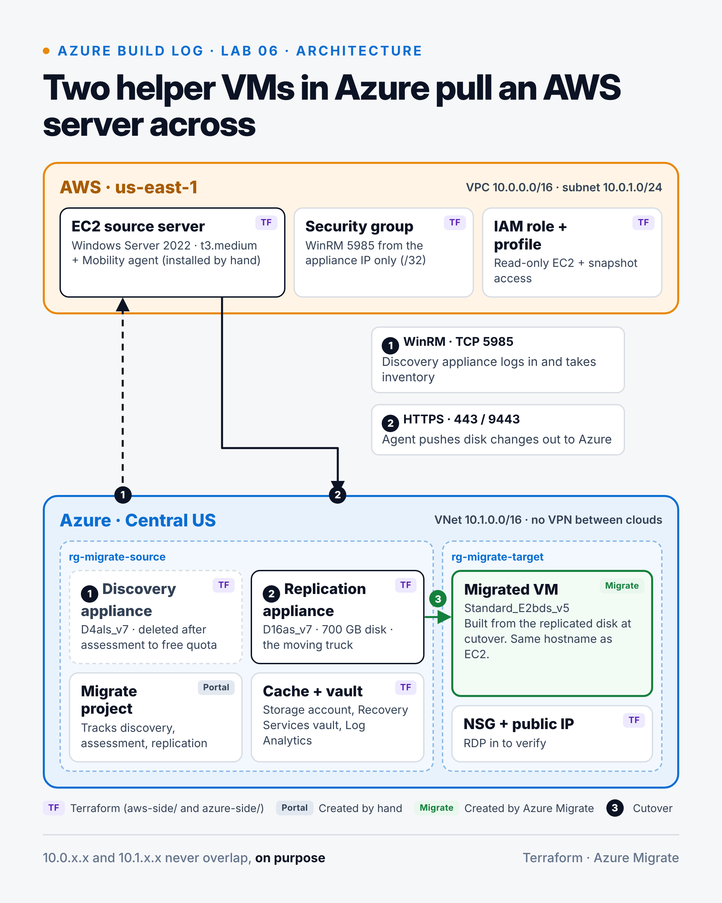
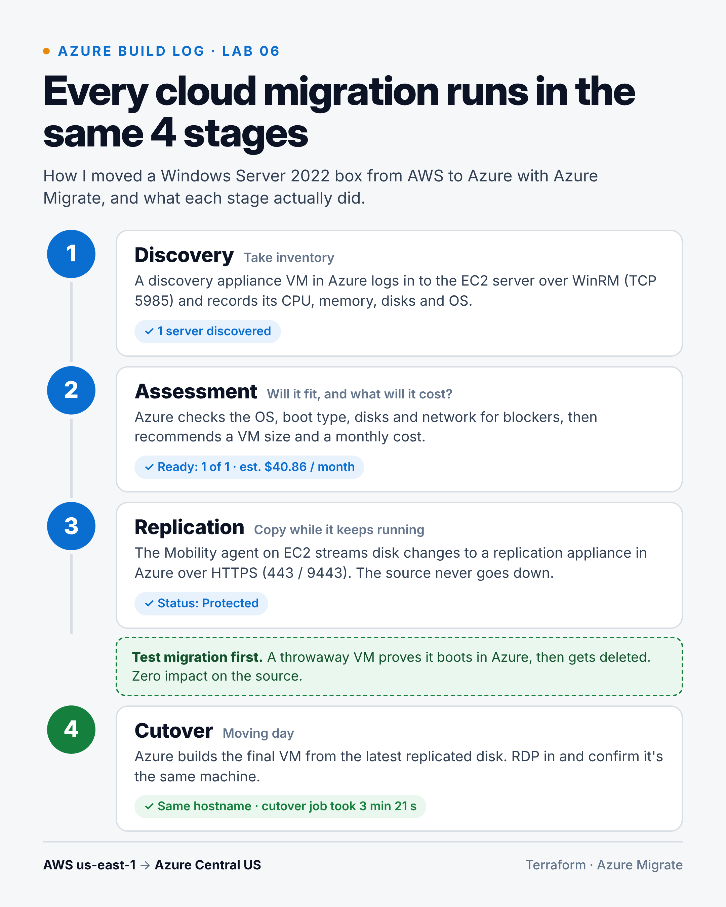
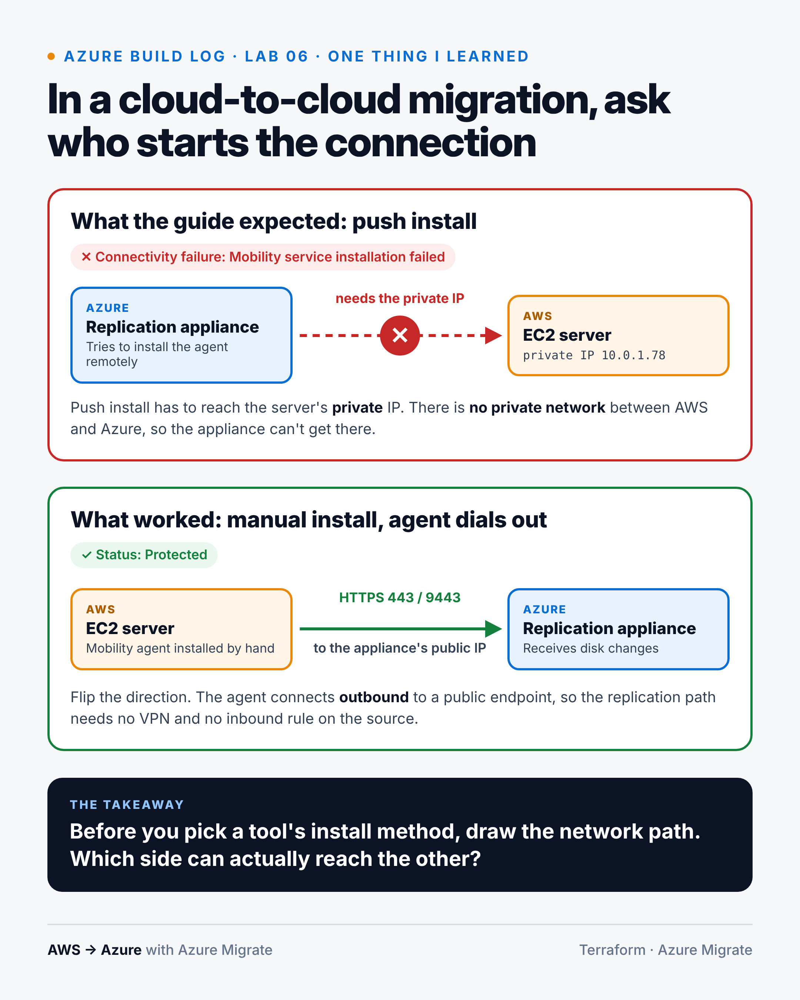
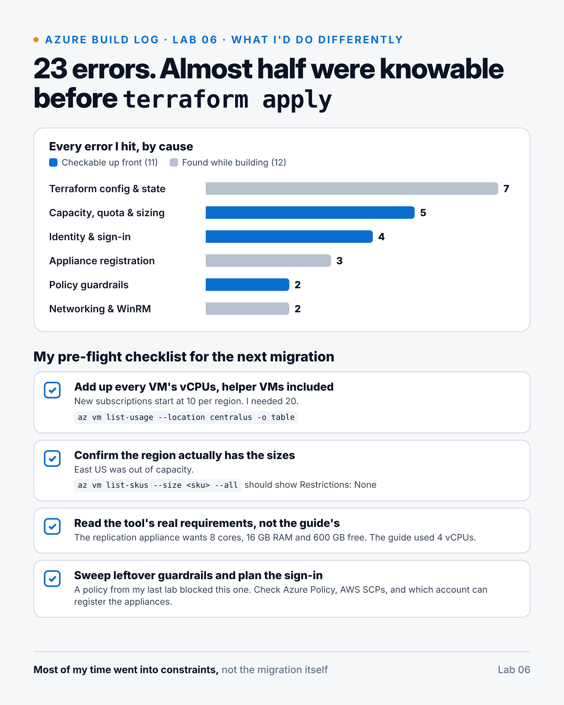

# Lab 06: AWS → Azure Migration with Azure Migrate

I moved a Windows Server 2022 machine from **AWS (us-east-1)** to **Azure (Central US)** with Azure Migrate. The full path was discovery, assessment, replication, a test migration, and the final cutover, with the infrastructure on both clouds built in **Terraform**.

> **Result:** the migrated VM booted in Azure with the same hostname as the EC2 server (`EC2AMAZ-L2B9ONI`). The cutover job took **3 min 21 s**. Getting there took 8 days and 23 errors, all documented below.



---

## What this lab demonstrates

| Skill | Where it shows up |
|---|---|
| Cloud migration (lift and shift) | The four stages, end to end, with a test migration before cutover |
| Multi-cloud Infrastructure as Code | Separate Terraform roots and state files for AWS and Azure |
| Network design | Non-overlapping CIDRs (10.0.0.0/16 vs 10.1.0.0/16); WinRM and 9443 locked to single `/32`s |
| Identity & security | Dedicated IAM user for Terraform, secrets kept out of Git, Security Defaults restored after use |
| Troubleshooting | 23 errors with root cause and fix ([troubleshooting.md](docs/troubleshooting.md)) |
| Cost awareness | Quota planning, deallocating the 16-vCPU appliance, same-day teardown of both clouds |

## The four stages



| Stage | What happened | Evidence |
|---|---|---|
| **1. Discovery** | The discovery appliance logged in to EC2 over WinRM (5985) and inventoried it | [12-discovered-server](docs/screenshots/12-discovered-server-ec2amaz-l2b9oni.png) |
| **2. Assessment** | **Ready: 1 of 1**, estimated **$40.86 / month** (compute $23.58, storage $2.40, security $14.88) | [13-assessment-ready](docs/screenshots/13-assessment-ready-for-azure.png) |
| **3. Replication** | Mobility agent (installed by hand) sent disk changes to the replication appliance; status **Protected / Healthy** | [17](docs/screenshots/17-mobility-agent-registered-on-ec2.png), [19](docs/screenshots/19-replication-protected-healthy.png) |
| **Test migration** | The `-test` VM booted to the Windows lock screen, then was cleaned up | [20-test-migration-boot-diagnostics](docs/screenshots/20-test-migration-boot-diagnostics.png) |
| **4. Cutover** | Failover succeeded in 3 min 21 s; `hostname` matched; `winver` showed Windows Server 2022 | [21](docs/screenshots/21-migration-jobs-test-and-failover.png), [23](docs/screenshots/23-migrated-vm-hostname-proof.png) |

## Repo layout

```
lab06-aws-to-azure-migrate/
├── terraform/
│   ├── aws-side/              # VPC, subnet, IGW, security group, IAM, EC2 (14 resources)
│   └── azure-side/            # RGs, VNet, cache storage, vault, Log Analytics, NSGs, both appliances
├── scripts/
│   ├── preflight-checks.ps1         # run BEFORE terraform apply (quota, SKUs, policy, identity)
│   ├── enable-winrm-on-ec2.ps1      # on EC2: open WinRM for discovery
│   ├── install-mobility-agent.ps1   # on EC2: manual agent install (push install can't reach AWS)
│   ├── attach-public-ip.ps1         # after cutover: RDP in and verify
│   └── teardown.ps1                 # both clouds, same day
└── docs/
    ├── runbook.md             # the condensed, working step-by-step
    ├── troubleshooting.md     # all 23 errors: cause, fix, category
    ├── images/                # diagrams
    └── screenshots/           # 25 redacted screenshots from my own run
```

## Built by Terraform vs. by hand

| Piece | How | Why |
|---|---|---|
| All AWS resources | Terraform (`terraform/aws-side`) | |
| Azure network, storage, vault, NSGs, both appliance VMs | Terraform (`terraform/azure-side`) | |
| Azure Migrate project | Portal | Terraform has no resource for it |
| Appliance registration & discovery | Appliance Configuration Manager | Interactive, device-code sign-in |
| Migrated VM, its disk and NIC | Created by Azure Migrate at cutover | That's the migration itself |

The appliances are switched with `deploy_discovery_appliance` / `deploy_replication_appliance`. The discovery VM has to be removed before the replication VM fits in a new subscription's vCPU quota.

## Quick start

> Full walkthrough: **[docs/runbook.md](docs/runbook.md)**. Expect real charges on both clouds, so tear down the same day.

```powershell
.\scripts\preflight-checks.ps1 -Location centralus   # fix anything it flags first

cd terraform\aws-side;   cp terraform.tfvars.example terraform.tfvars   # fill in
terraform init; terraform apply                               # 14 added

cd ..\azure-side; cp terraform.tfvars.example terraform.tfvars
terraform init; terraform apply                               # discovery phase
```

## One thing I learned: ask who starts the connection



Azure Migrate's push install failed:

```
Connectivity failure - Mobility service installation failed on the source machine (IP: 10.0.1.78)
```

Push install has to reach the server's **private** IP, and there's no private network between AWS and Azure. When I installed the agent by hand, it connected **out** to the replication appliance's public IP over 443 / 9443. That needed no VPN and no inbound rule on the source.

## What I'd do differently



About half the errors (11 of 23) were environment constraints I could have caught before writing any Terraform:

- **Quota first.** Add up every VM's vCPUs, helpers included. New subscriptions start at 10 per region; I needed 20.
- **Check regional capacity.** East US couldn't supply the sizes, so I moved to Central US.
- **Read the tool's real requirements.** The replication appliance wants 8 cores, 16 GB RAM, and 600 GB free.
- **Clean up after every lab.** A leftover Azure Policy from Lab 05 blocked this one.
- **Lock down admin access.** The lab ran with RDP open to `0.0.0.0/0`. The code now takes `admin_cidrs` / `admin_source_prefix` so you can set your own IP.

## Security notes

- `terraform.tfvars` (passwords) and `terraform.tfstate` are **git-ignored**. The AWS state file holds an IAM secret key in plain text.
- Screenshots are redacted: account and subscription IDs, access key ID, email, public IPs, and the agent registration token.
- Security Defaults was turned off **only** during appliance registration and turned back on right after. The temporary directory admin account was deleted at clean-up.
- Both clouds were torn down: AWS **14 destroyed**, and only `NetworkWatcherRG` remains in Azure ([24](docs/screenshots/24-aws-terraform-destroy-14-destroyed.png), [25](docs/screenshots/25-azure-clean-only-networkwatcherrg.png)).

## Cost (pay-as-you-go, approximate)

| Resource | Cloud | ≈ / hour |
|---|---|---|
| EC2 t3.medium (Windows) | AWS | $0.08 |
| Discovery appliance D4als_v7 | Azure | $0.35 (deleted after assessment) |
| Replication appliance D16as_v7 + 700 GB disk | Azure | $1.46 (the biggest cost: deallocate it from the portal between sessions) |
| Migrated VM E2bds_v5 | Azure | $0.27 |

---

← Back to [all labs](../README.md)
